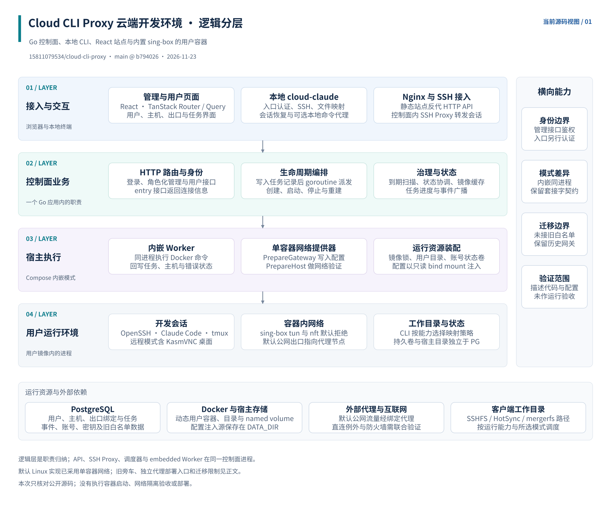
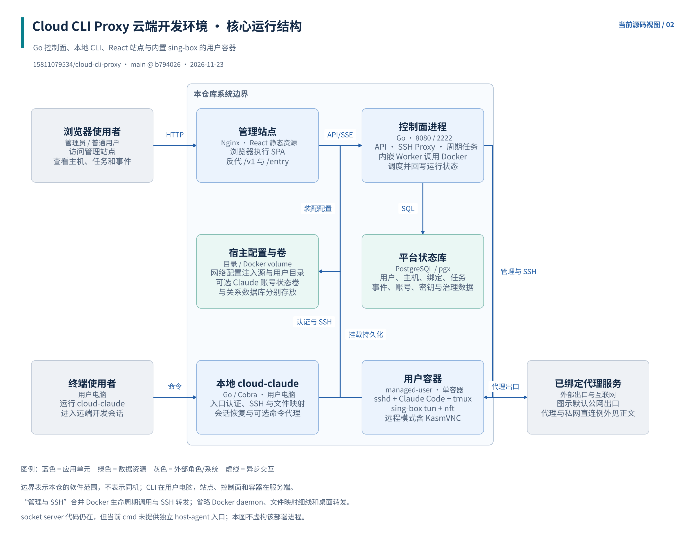

# Cloud CLI Proxy 当前源码架构

本仓同时包含 Go 控制面、本地 `cloud-claude` 客户端、React 管理及用户站点、用户容器镜像与网络运行代码。它围绕单台 Linux 宿主机上的 Docker 用户环境组织访问、生命周期和出口配置。下面两张图按实际调用关系归纳，不代表线上拓扑或运行验收结果。

核对日期：2026-11-23。分支：`main`。固定源码：[`b794026f7faf`](https://github.com/15811079534/cloud-cli-proxy/commit/b794026f7fafc737a9cd8bb26eb07aa81f8ab952)。

**当前默认 Linux 网络路径已经采用“用户容器内运行 sing-box”。** 既有指南中的旁车网关、独立 namespace 和部分部署描述属于历史背景，保留在本页末尾；判断当前行为时，以本节列出的入口和实现为准。仓内规划文件仍标记 v4.0 进行中，本次没有据此推断它已发布或已部署。

## 逻辑分层



| 职责 | 当前实现及边界 |
| --- | --- |
| 浏览器界面 | `web/admin` 由 React、TanStack Router 和 Query 组织管理与用户页面；请求层访问同源管理 API，事件 hook 使用 SSE 失效查询缓存并辅以轮询。静态资源由 Nginx 提供。 |
| 本地客户端 | `cmd/cloud-claude` 是独立 Go CLI。入口认证取得 SSH 参数，随后建立 SSH 连接、调度工作目录映射，再进入远端 Claude Code；会话层支持 tmux、保活、重连和多端接入。 |
| 控制面 | `cmd/control-plane` 初始化 PostgreSQL 仓储、HTTP 路由、任务调度、到期扫描、状态协调、镜像缓存和 SSH Proxy。它们是同一应用中的模块及 goroutine。 |
| 生命周期执行 | `runtime.Service` 先创建数据库任务，再在 goroutine 中调用 dispatcher。Compose 设置 `HOST_AGENT_MODE=embedded`，dispatcher 直接调用同进程 Worker；Worker 通过 Docker 命令执行创建、启动、停止和重建。没有独立消息队列服务。 |
| 容器网络与镜像 | Linux factory 返回 `ContainerProxyProvider`。创建前生成 sing-box 配置，用户镜像启动时在自身 netns 中运行 sing-box、设置 DNS 和 nft 规则；创建后调用网络验证与 SSH 就绪检查。 |
| 持久化 | PostgreSQL 保存平台结构化状态。用户目录、注入配置和 Docker named volume 属于宿主文件/卷资源；它们没有被当成数据库中的会话正文。 |

管理 API 的 `AuthMiddleware` 与 `RequireRole("admin")`、入口口令验证、SSH 密码/公钥解析各自承担不同边界。前端把会话保存在 localStorage，并附带 Bearer token；这不能替代服务端授权。本图没有声称所有低层 `/v1` 兼容路由都经过同一管理鉴权包装，具体注册范围以 `router.go` 为准。

## 核心运行结构



本图选择仓内 Compose 明确配置的 **embedded 模式**。Nginx 对 `/v1/` 与 `/entry/` 反代控制面；控制面 HTTP 默认监听 8080，SSH Proxy 默认监听 2222。图中的客户端运行在用户电脑，软件边界不等于单机边界。Docker daemon、客户端工作目录和 KasmVNC 转发等次要连接在图中省略，下面说明其职责。

### 1. 管理操作与主机生命周期

管理界面调用 API；`runtime.Service.QueueHostAction` 查询主机、用户与镜像锁，生成任务记录，携带目录、卷、资源限制和出口相关信息，随后异步派发。`EmbeddedDispatcher` 写入 running 状态，调用 Worker，并写入最终结果。任务进度和事件通过进程内广播通知页面；PostgreSQL 是持久化依据，广播本身没有外部队列或事件总线。

当前 `Worker.createHost` 的关键顺序是：准备用户目录及可选账号状态卷 → 生成网络配置 → 构造 Docker 参数 → 创建并启动用户容器 → 调用网络验证 → 等待 SSH。容器参数使用 Docker `bridge`、`on-failure` 重启策略、TUN/FUSE 设备、保留 NET_ADMIN 并移除 NET_RAW；这与原指南的 `network none` 路径不同。异常路径记录错误并清理本次注入配置，不能把数据库状态直接等同于容器已可用。

### 2. 客户端认证与开发会话

`cloud-claude` 主入口先做工作目录前置检查，再调用 `EntryClient.AuthenticateAndWait`。服务端 `EntryHandler.Auth` 校验账号状态和密码：主机已 running 时返回 SSH 连接参数及镜像能力；非 running 时返回 `not_ready`。**这条 entry 路径没有自动创建或启动主机的调用**，客户端的轮询等待不等于服务端已触发生命周期操作。

客户端根据返回参数连接 SSH Proxy；Proxy 查询目标容器并转发 session、direct-tcpip 以及远端端口转发通道。`ConnectAndRunClaudeV3` 建立连接、调用 `MountWorkspace`、按配置启动本地命令代理，检查绑定账号的凭据状态，再选择 tmux 包装或普通 PTY 路径。auto、full、hot-only、sshfs-only 是客户端可选映射模式；图中的单条 SSH 连接概括这些复用通道，没有虚构一个独立文件同步服务器。

### 3. 单容器网络与出口

`ContainerProxyProvider.PrepareGateway` 名字沿用历史，但当前实现负责在宿主写入配置，并不创建网关旁车。`buildCreateArgs` 把该文件以只读 bind mount 注入用户容器。镜像入口依次启动 sing-box、等待 tun0、设置 DNS、加载 nft 默认拒绝规则、尝试删除已加载配置，再启动退出监控；远程模式还启动 KasmVNC 桌面，最后以前台 sshd 承接会话。

当前 sing-box 配置使用 `auto_route`、`strict_route`，默认路由出口为 `proxy-out`；DNS 使用代理 DoH，并保留本地域名解析规则。配置中同时存在代理服务器地址与私网地址的 direct 规则，最终是否可达还受 nft 规则约束。因此这里描述的是**代码中的路由与拒绝策略**，没有把产品的“全流量无泄漏”目标当作本次已验证结论。

## 当前模式与历史内容的界限

| 主题 | 固定提交可证明的现状 |
| --- | --- |
| 独立 Host Agent | `app.go` 保留 Unix socket 客户端分支，`internal/agent/server.go` 保留服务端实现；当前 `cmd` 目录仅有 control-plane 与 cloud-claude，没有独立 host-agent 可执行入口。不能据此画成已经装配的第三个常驻进程。 |
| Compose 特权边界 | Compose 使用 embedded，并向控制面提供 Docker socket、宿主数据目录及能力配置。它没有形成“Web/API 完全不接触宿主特权”的独立代理隔离部署。 |
| 网关残留 | Compose 仍列出 gateway 等镜像服务，命令为 `true`；构建工作流也保留网关镜像。这些声明不等于当前 `createHost` 会创建一个常驻网关旁车。默认 provider 已使用单容器路径。 |
| 白名单治理 | 数据表、管理路由和旧网络辅助代码仍在，但 `buildContainerSingBoxConfig` 明确未包含旧 whitelist rule-set。不能由后台存在白名单页面推断该规则已接入当前默认网络配置。 |
| 配置装配一致性 | Worker 把配置作为 `:ro` 单文件挂载，入口随后对同一配置执行 `shred` / `rm`，并在删除失败时退出。两处源码存在需要处理和实机核验的装配冲突；本次只记录这一限制，没有修改运行行为或宣称启动成功。 |
| 发布与验收 | 本次没有启动 Docker、访问数据库或真实代理、读取真实凭据，也没有执行网络隔离测试。规划状态、注释、测试文件和镜像标签均不能单独证明生产部署状态。 |

## 源码证据索引

| 关注点 | 直接依据 |
| --- | --- |
| 应用装配与周期任务 | [control-plane main](../../../cmd/control-plane/main.go)、[app.go](../../../internal/controlplane/app/app.go) |
| 路由、鉴权范围与入口状态 | [router.go](../../../internal/controlplane/http/router.go)、[entry handler](../../../internal/controlplane/http/entry.go) |
| 任务与内嵌 Worker | [runtime_service.go](../../../internal/runtime/runtime_service.go)、[embedded_dispatcher.go](../../../internal/runtime/tasks/embedded_dispatcher.go)、[worker.go](../../../internal/runtime/tasks/worker.go) |
| 默认网络实现 | [provider_linux.go](../../../internal/network/provider_linux.go)、[container_proxy_provider.go](../../../internal/network/container_proxy_provider.go)、[container_singbox_config.go](../../../internal/network/container_singbox_config.go) |
| 用户镜像与网络启动 | [Dockerfile](../../../deploy/docker/managed-user/Dockerfile)、[entrypoint.sh](../../../deploy/docker/managed-user/entrypoint.sh)、[default-deny.nft](../../../deploy/docker/managed-user/default-deny.nft) |
| SSH 与 socket 契约 | [proxy.go](../../../internal/sshproxy/proxy.go)、[resolver.go](../../../internal/sshproxy/resolver.go)、[agent client](../../../internal/agentapi/client.go)、[agent server](../../../internal/agent/server.go) |
| CLI 主链路 | [CLI main](../../../cmd/cloud-claude/main.go)、[entry client](../../../internal/cloudclaude/entry.go)、[ssh.go](../../../internal/cloudclaude/ssh.go)、[mount_strategy.go](../../../internal/cloudclaude/mount_strategy.go)、[session.go](../../../internal/cloudclaude/session.go) |
| 前端及反代 | [main.tsx](../../../web/admin/src/main.tsx)、[api.ts](../../../web/admin/src/lib/api.ts)、[auth.ts](../../../web/admin/src/lib/auth.ts)、[use-events.ts](../../../web/admin/src/hooks/use-events.ts)、[nginx.conf](../../../deploy/docker/admin/nginx.conf) |
| 平台数据与卷引用 | [初始迁移](../../../internal/store/migrations/0001_initial.sql)、[SSH keys](../../../internal/store/migrations/0012_ssh_keys_table.sql)、[账号卷](../../../internal/store/migrations/0014_claude_account_persistent_volume.sql)、[旧白名单数据](../../../internal/store/migrations/0019_host_bypass_rules.sql) |
| 部署示例与文档发布 | [docker-compose.yml](../../../docker-compose.yml)、[docs.yml](../../../.github/workflows/docs.yml)、[build-images.yml](../../../.github/workflows/build-images.yml)、[release.yml](../../../.github/workflows/release.yml) |

## 图源维护

编辑源为 [`cloud-cli-proxy-architecture.drawio`](../../diagrams/cloud-cli-proxy-architecture.drawio)，含逻辑分层和核心运行两页。修改入口、dispatcher、网络 provider、镜像启动、数据归属或部署模式时，先同步图源与本节，再更新两张 PNG 和 [README 导航](../../../README.md)。本文只使用本公开仓证据。

当前预览由本地 XML/SVG 渲染链生成并经过图形检查；本环境未完成原生 draw.io 编辑器导出验证。`docs.yml` 会在 main 的 docs 路径变动时自动部署 Pages，本次文档交付使用独立分支。

---

<details>
<summary>既有架构说明（保留原文，作为历史参考）</summary>

# 架构说明

## 系统架构

```
┌─────────────┐   curl    ┌────────────────┐    Docker     ┌──────────────────────┐
│   终端用户   │ ────────> │  Control Plane │ ───────────>  │  用户容器             │
│  (SSH 客户端)│ <──────── │  (Go API :8080)│              │  SSH + Claude + VNC   │
└─────────────┘   SSH     └───────┬────────┘              └────────┬─────────────┘
       │                          │                                │
       │                   ┌──────┴───────┐               ┌───────┴─────────┐
       │                   │  PostgreSQL   │               │  sing-box tun   │
       │                   │  (状态持久化) │               │  (全隧道出口)   │
       │                   └──────────────┘               └───────┬─────────┘
       │                          │                                │
       │                   ┌──────┴───────┐               ┌───────┴─────────┐
       │                   │  Admin SPA   │               │  指定出口 IP     │
       └──── SSH ────────> │  (:80/nginx) │               │  (受控路由)      │
           代理 :2222      └──────────────┘               └─────────────────┘
```

## 核心组件

### Control Plane（控制面）

Go 编写的 API 服务，是系统的中央协调器：

- **HTTP API** — 提供管理员和用户面板的 RESTful 接口
- **认证** — JWT Token 签发，支持管理员和普通用户两种角色
- **任务编排** — 主机创建、启动、停止、重建等操作通过异步任务队列执行
- **到期扫描** — 定期检查用户到期状态，自动停机和禁用
- **SSH 代理** — 监听 `:2222`，将 SSH 会话代理到目标容器内部
- **状态协调** — 对账运行中的容器与数据库记录，修正不一致状态

### Host Agent（宿主机代理）

执行需要特权的宿主机操作，与控制面通过 Unix socket 通信：

- **Docker 管理** — 创建、启动、停止和删除用户容器
- **网络配置** — 创建网络命名空间、配置 sing-box tun
- **防火墙管理** — 为每个容器设置 nftables 默认拒绝规则
- **网络校验** — 三重校验：连通性、出口 IP 匹配、DNS 泄漏检测

两种运行模式：
- `socket` — 独立进程，通过 Unix socket 接收控制面指令（生产推荐）
- `embedded` — 嵌入控制面进程内运行（开发和 Docker Compose 部署使用）

### 用户容器

基于 Ubuntu 24.04 的受管镜像，使用 `--network=none` 创建以彻底隔离默认网络：

- OpenSSH Server — SSH 接入
- Claude Code — AI 编程助手
- KasmVNC + Fluxbox + Chromium — 远程桌面
- sing-box — 代理模式隧道客户端
- 常用开发工具 — Git、tmux、zsh、Node.js 等

### cloud-claude CLI

用户在本机安装的 Go CLI，是本地终端与远端容器之间的透明桥梁：

- **本地透明代理** — `alias claude=cloud-claude`，在本地终端直接运行远端 Claude Code
- **三层文件映射** — Auto（HotSync 优先，失败降级 SSHFS）/ Full（双轨并行）/ SSHFS-Only（纯 SSHFS）
- **tmux 会话管理** — 多端 attach 同一会话，支持 `--new-session` 独占、`--take-over` 接管
- **网络韧性** — Reconnector 1/2/4/8/30s 退避重连，BufferedStdin 输入缓冲不丢失
- **自检排障** — `doctor` 五维度自检 + `--fix` 自动修复，`explain` 错误码查询
- **命令代理** — `proxy_commands` 将 `git` 等命令代理到本机执行

### PostgreSQL

持久化所有系统状态：

- 用户账号、密码（bcrypt）和到期时间
- 主机记录、短 ID、SSH 密码和状态
- 出口 IP 配置（代理配置 JSONB）
- 主机与出口 IP 绑定关系
- 异步任务记录
- 审计事件（13 种事件类型）

## 网络模型

### 容器网络隔离

每个用户容器使用 `--network=none` 创建，创建后没有任何网络接口（除 loopback），无法直连任何外部网络。

### sing-box tun 代理隧道

```
用户容器 namespace
├── lo (loopback)
├── veth (连接到宿主机的虚拟网卡)
├── tun0 (sing-box tun 设备)
│   └── 路由：0.0.0.0/0 → tun0
└── nftables：默认拒绝，仅允许到代理服务器的连接
```

sing-box 以 tun 模式运行，捕获所有出站流量并通过指定代理协议转发。

### 三重网络校验

每次主机启动后执行三重校验，任一失败则主机不可用：

1. **连通性测试** — 从容器 namespace 访问外部 HTTP 端点
2. **出口 IP 匹配** — 检查实际出口 IP 是否与预期一致
3. **DNS 泄漏检测** — 确保 DNS 请求也走隧道，不直连

## 安全边界

### 特权分离

```
┌─────────────────────────────────┐
│  Control Plane（低特权）         │
│  - HTTP API + 业务逻辑          │
│  - 不直接接触 Docker / 网络     │
│  - 通过 Unix socket 委托操作    │
└─────────────┬───────────────────┘
              │ Unix socket
┌─────────────┴───────────────────┐
│  Host Agent（高特权）            │
│  - Docker 容器管理              │
│  - 网络 namespace 操作          │
│  - nftables 防火墙配置          │
│  - sing-box 管理                │
└─────────────────────────────────┘
```

Web / API 层不直接持有过宽的宿主机特权。所有 Docker 和网络命名空间操作都集中在 host-agent 中执行，通过 Unix socket 接口暴露给控制面。

### 用户隔离

- 每个用户独立容器，`--network=none` 创建
- 容器间无网络互通
- 用户只能通过 SSH（直连或代理）访问自己的容器
- JWT Token 区分管理员和普通用户角色，用户只能看到自己的资源

### 凭证管理

- 用户密码使用 bcrypt 哈希存储
- 管理后台使用 JWT Token 认证，密钥可轮换
- 容器 SSH 密码独立于用户登录密码

## 数据流

### Bootstrap 接入流程

```
用户 → curl /v1/bootstrap/script → 获取引导脚本
     → 脚本提示输入用户名和密码
     → POST /v1/bootstrap/sessions → 认证 + 排队启动任务
     → 轮询 GET /v1/bootstrap/tasks/{id} → 等待任务完成
     → GET /v1/bootstrap/tasks/{id}/handoff → 获取 SSH 连接参数
     → exec ssh → 进入容器
```

### Entry 短链接接入流程

```
用户 → curl /entry/{shortId} → 获取入口脚本
     → 脚本提示输入密码
     → POST /v1/entry/{shortId}/auth → 认证
     → 返回 SSH 连接参数（host, port, user）
     → ssh -p 2222 → 通过 SSH 代理接入容器
```

### cloud-claude 本地 CLI 接入流程

```
用户 → cloud-claude init → 写入 ~/.cloud-claude/config.yaml（网关 / Short ID / 密码）
     → cd 项目目录 → cloud-claude
     → POST /v1/entry/{shortId}/auth → 认证 + 获取 SSH 参数
     → sshfs 将本地 CWD 挂到容器内同名路径（Auto/Full/SSHFS-Only 三层映射）
     → 检测 tmux 会话 → attach 已有或新建
     → 在远端启动 Claude Code
     → 终端大小、信号、退出码透传
     → 网络抖动 → Reconnector 自动重连（输入缓冲回放）
```

### 主机启动任务流

```
控制面创建任务 → host-agent 接收
  → 拉取/检查受管镜像
  → 创建容器（--network=none）
  → 创建网络命名空间
  → 配置 sing-box tun
  → 配置 nftables 防火墙规则
  → 启动容器
  → 三重网络校验
  → 标记任务成功
```

## 架构原则

- **单宿主机优先** — 不为 v1 提前引入多节点调度复杂度
- **网络强约束优先** — 先保证"所有流量都必须走指定出口"
- **启动体验优先** — 建立在真实可验证的运行时正确性之上
- **特权最小化** — API 层与特权操作严格分离

## 项目结构

```
cloud-cli-proxy/
├── cmd/
│   ├── cloud-claude/           # cloud-claude 本地 CLI 入口
│   ├── control-plane/          # 控制面 API 入口
│   └── host-agent/             # 宿主机代理入口
├── internal/
│   ├── controlplane/           # HTTP 路由、业务逻辑、到期扫描、状态协调
│   │   ├── http/               # 路由注册和中间件
│   │   ├── app/                # 应用生命周期和依赖组装
│   │   ├── admin/              # 管理员 API 处理器
│   │   ├── scheduler/          # 到期扫描和定时任务调度
│   │   └── credgen/            # 凭证生成（SSH 密码、JWT Secret）
│   ├── agent/                  # host-agent 服务端
│   ├── agentapi/               # host-agent API 客户端（控制面调用 agent）
│   ├── broadcast/              # SSE 实时事件广播（topic-based pub/sub）
│   ├── cloudclaude/            # cloud-claude CLI 内部库
│   │   ├── doctor/             # 五维度自检排障 + --fix 自动修复
│   │   └── errcodes/           # 错误码注册表（8 域 51 条）
│   ├── local/                  # cloud-claude local Dev Containers 工作流
│   ├── network/                # nftables / sing-box 网络配置
│   ├── runtime/                # 任务运行时、Docker 容器生命周期
│   │   └── tasks/              # 异步任务定义和执行器
│   ├── sshproxy/               # SSH 代理（转发到容器 22 端口）
│   └── store/                  # 数据库迁移和查询（pgx）
│       ├── migrations/         # SQL 迁移文件
│       ├── migrator/           # 迁移执行引擎
│       └── repository/         # 数据访问层
├── web/admin/                  # React 管理后台（TanStack Router + Query）
├── deploy/
│   ├── docker/                 # 4 个 Dockerfile
│   │   ├── control-plane/      # 控制面镜像
│   │   ├── admin/              # 管理后台镜像
│   │   ├── managed-user/       # 用户容器镜像
│   │   └── sing-box-gateway/   # sing-box 网关 sidecar
│   ├── compose/                # 开发用 Compose 文件
│   ├── bootstrap/              # 用户 curl 引导脚本
│   ├── scripts/                # setup-env.sh、deploy.sh、backup.sh
│   └── systemd/                # systemd 服务单元
├── docs/                       # VitePress 文档站
├── docker-compose.yml          # 生产 Compose
├── Makefile                    # 开发命令入口
└── .github/workflows/          # CI/CD
```

## 技术栈

| 层 | 技术 |
|----|------|
| 后端 | Go 1.26.1, net/http 标准库, pgx v5 |
| 前端 | React 19.2, TypeScript, Vite, Tailwind CSS, TanStack Router/Query |
| 数据库 | PostgreSQL 18 |
| 容器 | Docker Engine 28, Ubuntu 24.04 用户镜像 |
| 网络 | sing-box tun + Linux netns, nftables |
| 桌面 | KasmVNC 1.4.0 + Fluxbox + Chromium |
| CI/CD | GitHub Actions，多架构构建 |

</details>
